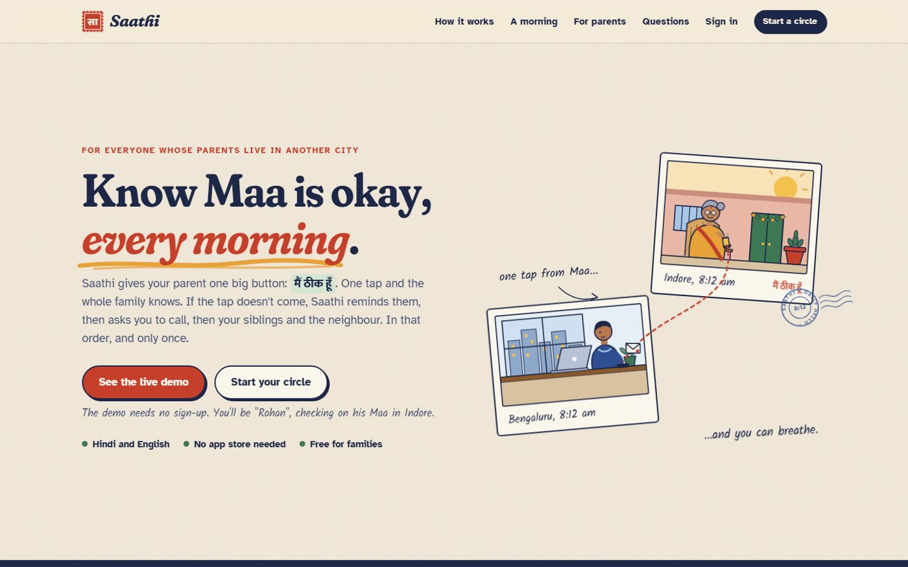
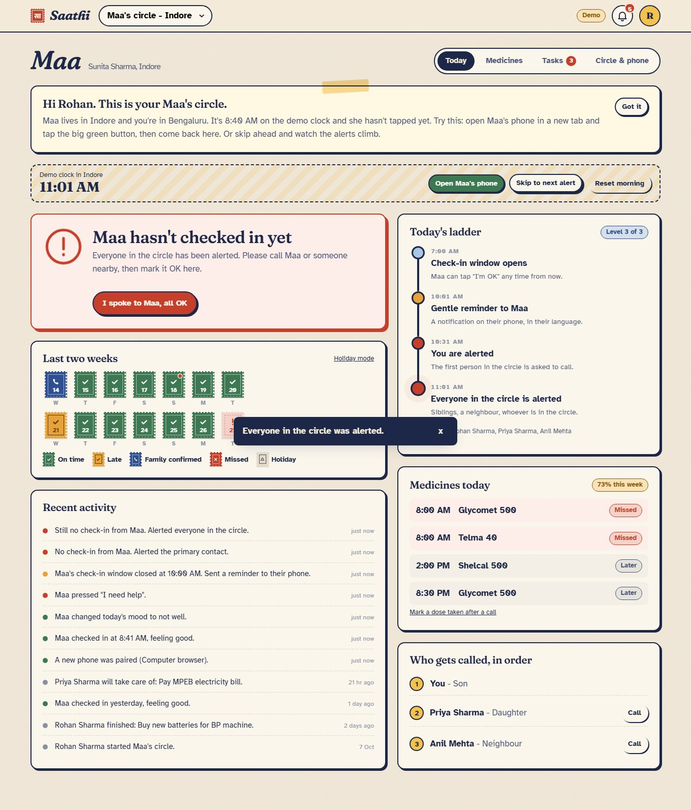
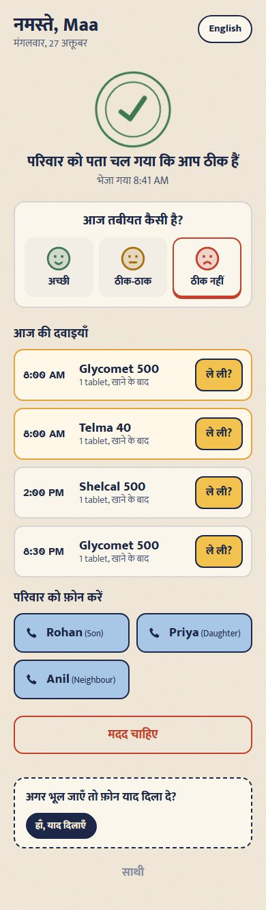
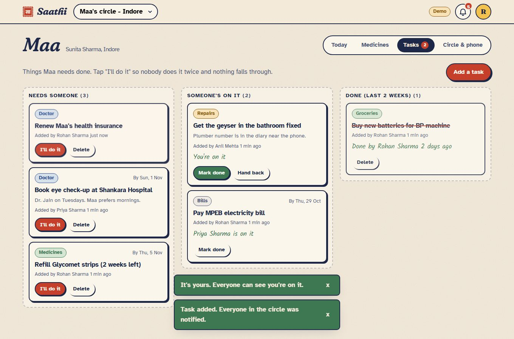
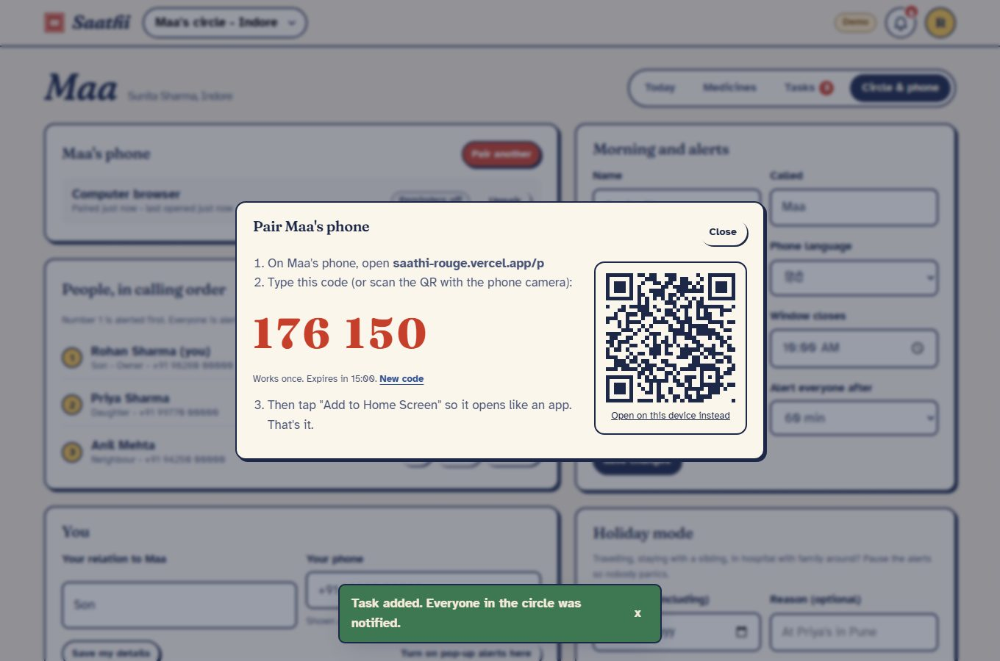
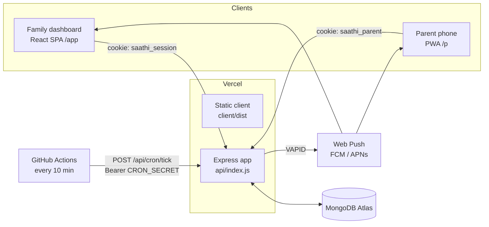
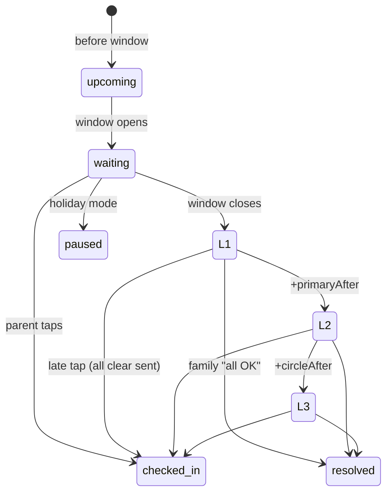

# Saathi

**A one-tap daily check-in for parents who live in another city. If it doesn't come, the right person in the family is alerted, in the right order.**

Live app: **https://saathi-rouge.vercel.app** (click "See the live demo", no sign-up needed)
Demo video: _link added on submission_



---

## Problem statement

Millions of Indians have moved to Bengaluru, Pune, Gurugram or abroad for work while their parents stay back in Indore, Lucknow or Kochi. Checking on them is a daily, unspoken worry with no system behind it:

- Maa's phone rings out at 9:40 AM. Is she in the puja room, is the phone on silent, or did she fall?
- You call Papa, then the neighbour, then your sister, who sees it at lunch. Nobody knows who is already handling it.
- Medicines get skipped, especially the evening dose, and nobody notices for weeks.
- "Who is taking Papa to the cardiologist?" gets lost in the family WhatsApp group.

This problem is ranked **#3 in the top 10 of [Razorpay's Fix My Itch](https://razorpay.com/m/fix-my-itch/)** (Healthcare), a list built from 50,000+ problems Indians posted, scored on severity and frequency:

> "Why is caring for aging parents for sole earners across cities still fragmented & stressful?"

Existing options do not fit: medical alert devices are expensive and stigmatising, location-tracking apps feel like surveillance, and a WhatsApp "good morning" only works until the morning it doesn't come.

## Target users

| User | Who | What they need |
| --- | --- | --- |
| **The child (primary)** | 25-40, working in another city, often the "default" one who checks | To know by mid-morning that the parent is fine, without calling ten times |
| **The parent** | 60+, basic smartphone, may prefer Hindi, may have shaky hands or weak eyesight | One obvious thing to do. No passwords, no jargon |
| **Siblings / neighbour** | Others in the "care circle" | A clear turn: only be pulled in if the first person can't confirm |

## Solution

Saathi turns "someone will notice" into a clock and a ladder:

1. **The parent taps "मैं ठीक हूँ / I'm OK"** once a day on a screen designed for them (one huge button, Hindi first, then optional mood and medicine ticks).
2. **If the tap doesn't come by the end of their window**, an escalation ladder climbs, one step at a time and never twice:
   - **L1** window closes: a gentle reminder on the parent's own phone
   - **L2** +30 min: the first person in the circle is alerted and asked to call
   - **L3** +60 min: everyone in the circle (siblings, neighbour) is alerted
3. **Anyone can stop the ladder**: the parent checks in late (everyone who was alerted gets an "all clear"), or a family member marks "I spoke to Maa, all OK" with a note.
4. Around that core loop: a medicine schedule with adherence tracking, and a sibling task board where "I'll do it" can only be claimed by one person.

## Key features (the 5 workflows)

| # | Workflow | What makes it more than CRUD |
| --- | --- | --- |
| 1 | **Create a care circle and invite family** | Owner/member roles, escalation order, single-use expiring invite links (stored hashed), atomic join |
| 2 | **Pair the parent's phone** | 6-digit code or QR, single-use, 15-minute expiry, rate limited. Phone gets a revocable device token, so the parent never sees a login screen |
| 3 | **Daily check-in + escalation ladder** | Pure, unit-tested state machine; idempotent tick; timezone-correct "today"; conditional updates so concurrent cron runs never double-alert; holiday mode; "all clear" fan-out; urgent "I need help" button |
| 4 | **Medicines and adherence** | Dose slots per day, parent ticks or family marks after a call, missed-dose detection, 7-day adherence that ignores doses not yet due |
| 5 | **Sibling task board** | Claiming is a single conditional update: two siblings tapping at the same moment get exactly one winner and the other is told who took it |

Plus: in-app notification inbox, Web Push (VAPID) for family and parent phones, activity timeline, 14-day "stamp" calendar, installable PWA for the parent (`/p`), and a **one-click private demo** with a virtual clock so evaluators can watch the ladder fire without waiting until 10 AM.

| Dashboard during an escalation | Parent's phone |
| --- | --- |
|  |  |

| Task board | Pairing a phone |
| --- | --- |
|  |  |

## Tech stack

| Layer | Choice | Why |
| --- | --- | --- |
| Frontend | React 18, Vite, React Router, TanStack Query | Query handles caching, polling (the ladder moves on its own) and loading/error states consistently |
| Styling | Hand-written CSS with design tokens, custom SVG illustrations | A specific visual identity (Indian inland letter / post office) instead of a component kit |
| Backend | Node 22, Express 5, Zod | Express 5 forwards async errors natively; Zod validates every request body |
| Database | MongoDB Atlas + Mongoose | Document model fits circles with embedded members; unique indexes enforce idempotency |
| Auth | bcrypt + JWT in httpOnly cookie (family), hashed opaque device tokens (parent phones) | Same-origin cookies, no tokens in localStorage, parent phones revocable |
| Notifications | In-app inbox + Web Push (`web-push`, VAPID) | No paid SMS/email provider needed; push works on Android and on iOS 16.4+ home-screen apps |
| Time | Luxon | "Today" and "10:30 AM" are computed in the parent's timezone, not the server's (Vercel runs in UTC) |
| Hosting | Vercel (static client + Express as one serverless function), GitHub Actions scheduler | Same origin for API and app, zero servers to babysit |

## Architecture



```
server/src
  app.js              Express app (shared by local server and Vercel function)
  index.js            local entry: listens + runs the ladder every minute (node-cron)
  services/ladder.js  the escalation rules as pure functions (no DB, no clock) <- unit tested
  services/days.js    applies the rules to Mongo: check-ins, tick, conditional updates
  services/medicines.js, overview.js, notify.js, demo.js
  routes/             auth, circles, care (medicines + tasks), parent, invites, me, system
  middleware/         auth (JWT + device tokens + membership), validation, errors, rate limits
  models/             User, Circle, Day, Medicine, DoseLog, Task, Notification, Activity, Invite, PairingCode, ParentDevice
client/src
  pages/Landing.jsx   marketing page with a live "morning simulator" and a working phone mock
  pages/app/*         dashboard tabs: Today, Medicines, Tasks, Circle & phone
  pages/parent/*      the parent's app (pairing + one-button home)
  components/         ParentScreen (shared by the real app and the landing mock), Ladder, Stamps
api/index.js          Vercel serverless entry
```

### The escalation ladder



Key engineering decisions:

- **Rules are pure, effects are separate.** `evaluateDay(circle, day, now)` decides the state and target level. The cron job, the dashboard and the parent screen all call it, so they never disagree. 19 unit tests cover thresholds, punctuality, holiday mode, late cron runs and UTC vs IST date boundaries.
- **Exactly-once alerts.** Moving up the ladder is `findOneAndUpdate({ level: { $lt: target }, checkedInAt: null, resolution: null })`. If two schedulers run at once, or the parent taps in the same second, only one update wins, and only the winner sends notifications.
- **Two schedulers, one truth.** GitHub Actions calls `/api/cron/tick` every 10 minutes (Vercel's free cron is daily only). The dashboard also ticks lazily on every load, so what you see is always correct even if a scheduled run is late.
- **Idempotent parent actions.** One Day document per circle per local date (unique index). A double tap on "I'm OK" or on a dose returns the existing record instead of creating a duplicate.
- **Local time, always.** All "today" logic uses the circle's timezone through Luxon. A check-in at 00:30 IST counts for the right day even though the server clock says it is still yesterday in UTC.
- **Credentials that can't be replayed from a DB leak.** Invite tokens, pairing codes and parent device tokens are stored only as SHA-256 hashes. Pairing codes are single-use, expire in 15 minutes and are rate limited.
- **Authorization by membership.** Every `/circles/:id` route loads the circle and checks membership; non-members get 404 (not 403) so circle ids can't be probed. Owner-only actions (settings, invites, delete, call order) are enforced on the server.
- **Demo without fake data paths.** `POST /api/demo` creates real users, a real circle and three weeks of real documents. Demo circles carry a clock offset (`demoOffsetMin`) so "Skip to next alert" moves time forward and runs the exact same ladder code. Demos are deleted after 48 hours.

### Error handling

Every API error has the same shape `{ error: { code, message, fields? } }`. Validation errors return field-level messages that the forms show inline. Duplicate keys return 409, unreachable DB returns 503 with a friendly message, unknown routes 404. On the client every screen has loading skeletons, empty states, error states, and toasts for success/failure. Concurrency conflicts (task already taken, day already resolved) explain who got there first.

## Local setup

Requirements: Node 20+ and a MongoDB connection string (Atlas free tier works).

```bash
git clone https://github.com/shreyansh-malviya/saathi.git
cd saathi
npm install                      # installs server and client workspaces
cp .env.example server/.env      # then fill in the values
npm run dev:server               # API on http://localhost:5050 (also runs the ladder every minute)
npm run dev:client               # app on http://localhost:5173 (proxies /api to 5050)
```

Generate VAPID keys for push notifications with `npx web-push generate-vapid-keys`.

### Tests

```bash
npm test                                         # unit tests for the ladder and time handling
BASE=http://localhost:5050 npm run smoke -w server   # 49-step API smoke test against a running server
```

## Environment variables

| Variable | Required | Description |
| --- | --- | --- |
| `MONGODB_URI` | yes | MongoDB connection string, including the database name (e.g. `/saathi`) |
| `JWT_SECRET` | yes | Long random string used to sign family sessions |
| `CRON_SECRET` | yes in prod | Bearer token the scheduler must send to `/api/cron/tick` |
| `VAPID_PUBLIC_KEY` / `VAPID_PRIVATE_KEY` | optional | Web Push keys. Without them, alerts still appear in the in-app inbox |
| `VAPID_SUBJECT` | optional | `mailto:` contact for push services |
| `CLIENT_URL` | yes in prod | Public URL, used in invite and pairing links |
| `PORT` | no | Local API port (default 5050) |

See [.env.example](.env.example). Real values are never committed.

## Deployment

- **App + API:** Vercel project with `vercel.json` - builds `client/` to `client/dist`, serves `api/index.js` (the Express app) as a Node serverless function, rewrites `/api/*` to it and everything else to the SPA.
- **Scheduler:** `.github/workflows/escalation-tick.yml` calls the tick endpoint every 10 minutes using the `APP_URL` and `CRON_SECRET` repository secrets. Vercel Cron runs it once a day as a backstop.
- **CI:** `.github/workflows/ci.yml` runs the unit tests and the client build on every push.
- Production: **https://saathi-rouge.vercel.app**

## Demo video

A 4-minute walkthrough (link at the top of this README). It was made in code with [Remotion](https://www.remotion.dev/) in an "editorial collage" style: motion-graphic scenes mixed with Playwright screen recordings of the live production app, a neural Indian English narration and a synthesized tanpura background. The video project is kept outside this repository.

## Limitations and next steps

- Push notifications need the browser's permission; on iPhone they require adding Saathi to the home screen. The in-app inbox always works. An SMS or WhatsApp fallback for the L3 alert would be the next addition.
- Parents need a smartphone with internet. A feature-phone flow (missed-call check-in) would widen reach.
- Rate limits are per serverless instance; a shared store (Redis) would make them global.

---

Built by Shreyansh Malviya for the Scaler end-term project. Problem source: Razorpay Fix My Itch.
